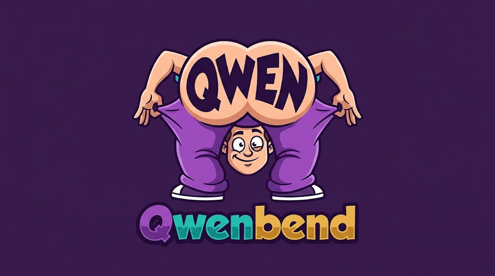

<p align="center"></p>

# QwenBend

**Qwen3.5-0.8B writes a Bend program. Then the same model type-checks it and runs it inside its own
forward pass.** No compiler, no interpreter, no tool call: one checkpoint, one `forward()` per token.

[▶ 15-second demo](assets/qwenbend.mp4)

```
you:   Sum 22 copies of 35.

Qwen:  import Base

       def run(+c: Nat) -> U32:
         match c:
           case 0n:
             0
           case 1n+p:
             (35 + run(p) : U32)

       def main() -> U32:
         run(22n)
       <|im_end|>

then, the same model: 7,869 more tokens: one executed instruction (or one byte of its result) each
answer read from the model's own trace: 770   (trace == reference interpreter, token for token)
```

## What it is

QwenBend is a stock HF `Qwen3_5ForCausalLM` with two parts:

1. **Qwen3.5-0.8B with a LoRA** (rank 8, trained here) that writes **BendLite**, a subset of
   [Bend2](https://github.com/HigherOrderCO/Bend). See [docs/BENDLITE.md](docs/BENDLITE.md).
2. **A small CPU built directly into the weights.** The engine was not trained. Every weight is
   set by construction ([`bendvm/engine_circuit.py`](bendvm/engine_circuit.py)):
   - 16 registers and 8,192 words of memory, held in Gated DeltaNet heads as one-hot rows;
   - an ALU and control logic made of SwiGLU units used as exact AND gates;
   - all values exact in bf16. This is checked bit for bit against a numpy evaluator
     ([`bendvm/circuit.py`](bendvm/circuit.py)) and in real torch.

While Qwen writes, the engine's layers quietly capture each token into memory. When Qwen emits
`<|im_end|>`, the next tokens are the engine's. Each one is an executed instruction (`INS(pc)`) or
a byte of the value it computed. The firmware running on that CPU
([`bendvm/firmware2.py`](bendvm/firmware2.py)) does three things:
1. lexes Qwen's tokens;
2. **applies Bend2's static rules**: U32 / Nat / Bool typing (`5` vs `5n`), affine use (a variable
   used twice must be `+`), and structural termination (recursion shrinks the `1n+p` binder);
3. compiles and evaluates.

The model reads its own trace back on the next step; that is the only state it carries forward.

Layer layout, hidden 4096:
- 10 engine layers;
- 1 exit layer, which zeroes the engine's dims exactly before Qwen sees them;
- Qwen's 24 layers, zero-padded.

## What it verifies, and what it doesn't

- ✅ The program passes Bend2's static rules. A program that breaks them fails inside the forward
  pass.
- ✅ The answer is exactly what that program computes, and the trace is a replayable record of
  every instruction and value.
- ❌ It does **not** verify that Qwen wrote the *right* program for the question. Exact ≠ true.
  The writer is a 0.8B model, and on our test set it is correct 42% of the time (80% on familiar
  task families, 4% on held-out ones).

## Measured

| check | result |
|---|---|
| end to end on Apple M4 Pro (MPS, bf16): Qwen writes → model runs | **5/5 correct**: sum_const 770 (7,869 tokens, 402 s), gcd ×2 (16,299 / 16,630), digit_sum 33 (16,447), triangle 780 (10,937); every trace == reference token for token |
| engine circuit vs numpy exact evaluator | 39,913 positions exact (3 programs) |
| engine in real `Qwen3_5ForCausalLM` (bf16, MPS) vs evaluator | 3,230 positions bit for bit |
| firmware vs Python oracle vs reference interpreter | 0 mismatches on 2,389 programs |
| reference interpreter vs real Bend2 | 1,100/1,100 values; 0 unsound on all model-written programs |
| LoRA (`bendtune/eval.py`, 200 test items, real Bend2) | 42% correct (80% in-distribution, 4% held-out); base model 0% |
| speed | about 20 tokens/s; a run takes 7–14 minutes |

**Size, honestly:**
- 3.97B dense parameters: **0.753B are Qwen's, 52.9M are the engine's nonzero weights**, and the
  rest is zero padding from widening the hidden size to 4096.
- The engine needs about 3,000 residual dims, and HF requires one width for all layers.
- The lm_head is tied to the embedding.

## Limits

- Programs under 192 tokens, BendLite only, 32-bit integers, 8,192 words of memory.
- Traces median 7.5k tokens (up to about 50k tested).
- Slow by design: it is one instruction per forward pass of the whole model.
- Proofs and laws of Bend2 are not checked (they are erased in BendLite). Types and termination
  are checked.
- Qwen never gets the turn back after the engine runs.

## Run it

```bash
pip install -r requirements.txt
python bendvm/qwenbend.py "Sum 22 copies of 35."
```

- Needs an Apple-silicon Mac (MPS) or a CUDA GPU with about 9 GB free.
- On first use it downloads Qwen3.5-0.8B (pinned revision) and the LoRA adapter from the Hugging
  Face Hub. [`bendvm/paths.py`](bendvm/paths.py) lets you point at local copies.
- The model is built in memory in about 15 s and never written to disk.

**Checks:**

```bash
python bendvm/test_bytecode.py --bvm bendtune/logs/tuned400_test.jsonl   # firmware == oracle == reference
python bendvm/engine_circuit.py 3 bendtune/logs/tuned400_test.jsonl      # circuit == VM, exact (CPU, slow)
python bendvm/test_engine_torch.py 2 1500                                 # circuit in real torch, bit for bit
python bendvm/merge.py 5                                                  # end to end, 5 programs
```

**Training data and eval:**
- `bendtune/gen_data.py` generated the programs; every one was checked with real Bend2.
- `bendtune/eval.py` is the evaluator.
- The LoRA was trained with `mlx_lm` (rank 8, scale 20, lr 1e-4, batch 2, 16 layers). The 400-step
  checkpoint was best by validation loss.

**Design notes:** [docs/DESIGN.md](docs/DESIGN.md).

## Credits

- [Qwen3.5-0.8B](https://huggingface.co/Qwen/Qwen3.5-0.8B) (Apache-2.0).
- [Bend2](https://github.com/HigherOrderCO/Bend): the language and the static rules reimplemented
  here.
- [Qwenputer](https://github.com/divagr18/qwenputer) (MIT) showed a CPU can live in Qwen3.5's
  weights. QwenBend uses none of its code; its ideas (e.g. DeltaNet state as RAM, counting without
  positions) are cited in the design notes.

Built at [Ampixa](https://ampixa.com). Licensed Apache-2.0.
