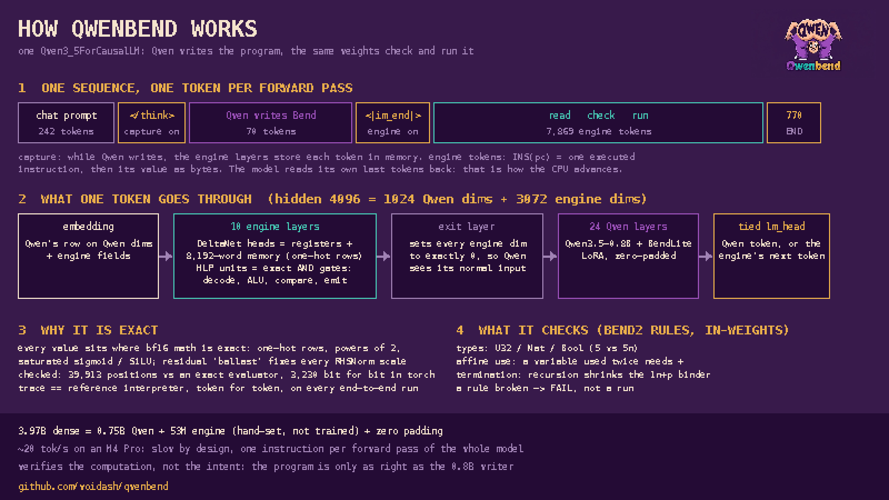

# How QwenBend works



QwenBend is **one** HF `Qwen3_5ForCausalLM` checkpoint. It is built in memory from Qwen3.5-0.8B, a
small LoRA, and an engine whose weights are set by construction. This page explains what happens
token by token, how a transformer can act as an exact CPU, and what that buys.

## 1. One sequence, one token per forward pass

```
[chat prompt] </think> [Qwen writes the Bend program] <|im_end|> [engine tokens ...] END
                 │                                         │
           capture on                                 engine on
```

**Qwen writes.** The fine-tuned Qwen3.5-0.8B writes a BendLite program, a subset of Bend2.
Meanwhile the engine layers, which sit in separate residual dimensions, store each token into
their memory.
- `</think>` (the end of the chat prompt) clears all engine state and starts capture.
- Each token is stored as four 32-bit words from a lookup table baked into its embedding row: the
  lexer handler to run and its payload.

**`<|im_end|>`** ends Qwen's answer. Here the engine's logits take over: from now on every next
token is the engine's.

**The engine runs.** Every engine token is either `INS(pc)` (an instruction being executed) or a
byte of the value that instruction computed.
- The next forward pass sees those tokens as input, latches the instruction, reads registers,
  computes and writes. That is the CPU's clock.
- The firmware it executes (`bendvm/firmware2.py`, about 2,200 instructions) does three things:
  1. **lexes** the stored tokens into BendLite words;
  2. **checks** the program with Bend2's static rules: U32 / Nat / Bool types (including `5` vs
     `5n`), affine use (a variable used twice must be declared `+`), and structural termination
     (recursion must shrink the `1n+p` binder). A program that breaks a rule ends in `FAIL`;
  3. **compiles** it to compact code, then **evaluates** it.
- `OUT` prints the result, `HALT` stops, and `END` is the last token.

For "Sum 22 copies of 35": 242 prompt tokens, 70 program tokens, 7,869 engine tokens, answer 770.

## 2. What one token goes through

The hidden size is 4096: dims 0–1023 are Qwen's residual, 1024–4095 the engine's.

| stage | what it does |
|---|---|
| embedding | Qwen's own row on Qwen dims; the engine's input fields (token kind, instruction fields, value bytes, the lexer's ROM words) on engine dims |
| **10 engine layers** | Gated DeltaNet heads hold the registers and the 8,192-word memory (64 heads × 128 rows, one-hot keys). SwiGLU units act as exact AND gates: instruction decode, ALU (add / sub / compare / xor / rotate / shift), address decode, next-token select |
| exit layer | an MLP that sets every engine dim to exactly 0 at Qwen's positions, so Qwen sees its normal input |
| 24 Qwen layers | Qwen3.5-0.8B with the LoRA fused in, zero-padded to width 4096; its norm weights are halved for the mean over 4096 dims |
| tied lm_head | Qwen's tokens score on Qwen dims; the engine's tokens score on the dims where the engine wrote its next token |

## 3. Why it is exact

A neural network can only act as a CPU if every step is bit-exact. QwenBend keeps every value where
bf16 arithmetic has no rounding:

- **One-hot rows.** A 32-bit value is 8 one-hot nibbles, each a 16-dim field with a single 1.0.
  Memory keys are one-hot, and `l2norm(c·e_i) = e_i` exactly.
- **Saturated gates.** Every SwiGLU unit is an AND gadget: `gate = 256·(Σ features − n) + 128`
  makes SiLU either exactly 128 or exactly 0. Sigmoids (DeltaNet's β) sit at exactly 0 or 1.
  Decays are exactly 0 (clear) or 1 (keep).
- **Ballast for RMSNorm.** Every token's embedding carries extra powers of 2, so every row's
  energy is exactly 4096·4³. The norm then scales by exactly 2⁻³ at every layer. Every head's
  output cancels as much "reserve" energy as it adds, so this holds at every layer.
- **Tiny exact values.** Capture counters are exact powers of 2 small enough for the norms to
  absorb. Apple's GPU flushes subnormals to zero, and that is modelled.

**How this is verified:**
- `bendvm/circuit.py` is an fp64 evaluator that raises an error whenever any intermediate value
  is not exactly representable.
- The engine passes it on 39,913 positions.
- The same weights in real torch (bf16, MPS) match it bit for bit on 3,230 positions.
- End to end, the model's trace equals the reference interpreter's, token for token, on every run.

## 4. What it verifies, and what it doesn't

- ✅ The program obeys Bend2's static rules. This is checked inside the forward pass.
- ✅ The answer is exactly what that program computes. The trace is a replayable record of every
  instruction and value: anyone can re-run it with the reference VM.
- ❌ Whether the program is the *right* program for the question. That depends on the 0.8B writer.
  Exact ≠ true.
- ❌ Bend2 proofs and laws: BendLite erases them.

## 5. Why do this

- **Exact computation without tools.** The model can carry out a long, exact computation (loops,
  recursion, 32-bit arithmetic) in its own weights. There is no sandbox, no tool call and no
  round trip, and no arithmetic hallucination.
- **An audit trail.** The whole execution is a token trace, so a reader or a verifier can check
  each step.
- **It scales in the right direction.** The engine needs about 3,000 residual dims and 53M
  nonzero weights whatever model it sits in. In a 0.8B model that forced the width from 1024 to
  4096, so 3.97B dense parameters are mostly zeros. In a frontier-width model it would be a small
  fraction of the width, and a stronger writer makes the "right program" part far more reliable.

## 6. The honest costs

- **Slow.** Each instruction is one forward pass of the whole model: about 20 tokens/s on an M4
  Pro, so 7–14 minutes for these programs. A real CPU does this in microseconds. The point is
  *where* the computation happens, not its speed.
- **Small scope.** Programs under 192 tokens, BendLite only, 32-bit integers, 8,192 words of
  memory.
- **One way.** After the engine runs, Qwen doesn't get the turn back. Handing the exact result back
  to the model is the natural next step.
